# Autodrom Sosnová for Assetto Corsa (v12.0)

A drivable Assetto Corsa (2014) track of Autodrom Sosnová near Česká Lípa, Czech Republic, as the place really is.

**Download:** [`download/sosnova_v9.zip`](download/sosnova_v9.zip). Install notes are in
[`content/tracks/sosnova_v9/INSTALL.txt`](content/tracks/sosnova_v9/INSTALL.txt). Delete older `sosnova*`
folders from `content/tracks` first. The folder keeps the name `sosnova_v9`; the game shows it as
"Autodrom Sosnová v12.0".

## What v12.0 is

The owner asked for the exact original track, with the surface of version 11 and with barriers, started from
scratch. So the designed racetrack of versions 9 to 11 (one 9 m road, grass verges, red and white kerbs, gravel
traps on every corner) is gone. Version 12 takes the shape of everything from the 12.5 cm aerial photo of the
Czech state survey.

| Part | How it is made |
| --- | --- |
| The paved outline | `tools/realmap.py`. The hard-surface mask of the photo is cut to the circuit (a loose hand-traced boundary), cleaned of cars, paint and shadows, and its edge is smoothed over 1.6 m, once more after the concrete strips are added. The result is one outline of everything that is paved: 32,200 m2 with 13 grass islands. `check.py` compares the built surface with it at 55,000 points; one differs. |
| The lap | The route of the race of 14.11.2026, 1764 m anticlockwise, under the green bridge. Its half widths are the distance from the centre line to the real asphalt edge on each side: 6.3 m wide at the narrowest, 20.1 m in turn 1, 11.2 m on average. Where the asphalt runs on (junctions, the big square, the start area) the lap keeps a strip of its own, 5.5 m to that side, and the rest is the asphalt beside it. |
| Surface of the lap | As in 11.0: one texture for every 28 m, baked from the photo of exactly that piece (light and dark pattern of the real asphalt), over a close-up scan of asphalt, with the rubbered line on top. Wide pieces get a wider texture. |
| Surface beside the lap | New: the asphalt off the lap is cut into 40 m squares, each with its own texture baked the same way from the photo. The lap strip and the asphalt beside it meet in the same plane (largest difference 12 mm at 35 cm out). |
| Concrete | The real kerbs of Sosnová are flat strips of grey concrete along the asphalt edge. They are found in the photo (bright patches traced by `paint.py`, and pale colourless ground right outside the asphalt edge) and built as part of the surface, 960 m2 with the white pad on the inside of turn 1. Physical surface `APRON`. There are no red and white kerbs any more. |
| Sand | Only where the photo shows it: outside turn 1 and at both ends of the west loop, 1,700 m2. Physical surface `SAND`. |
| Barriers | The tyre walls traced from the photo, plus three hand-traced lines where the tracing left gaps (the wall along the east side, the white barrier and the tyres outside turn 1): 27 lines, 475 m built. With the wall along the pit buildings and the paddock wall, both with a wire fence. |
| Paint | The lines and start boxes of the real asphalt, traced from the photo (74 lines, 20 boxes). A white line runs along every real edge of the lap. It stops 2 m short of the places where the asphalt runs on. |
| Around the track | The grass tiles keep the real photo away from the asphalt: the paddock, the yards, paths and bare earth look as they are. Only within 4 m of the asphalt the photo is filled with grass colour, so paint and cars do not bleed into the verge. |
| Race layout | Unchanged from 9.5 and 9.6: tyre stacks at the organiser's 33 yellow dots and at 8 points of the line the owner drew, yellow bags and tape along the 7 rows. Cones now stand every 8 m on both sides of the lap strip where it crosses open asphalt (91 cones), so the route can be seen across the big square. |
| Heights | The lap is a smooth analytic surface fitted to the lidar terrain (range 2.8 m). The asphalt beside it continues the plane of the lap for 1.5 m and turns into the terrain over the next 4.5 m. Small bumps of the terrain model are relaxed. |
| Still from the survey | The green arch bridge, buildings with their heights and photo roofs, pylons, trees at measured heights, the terrain and the distant ground photo. |

## Rebuilding

```
pip install numpy scipy pillow opencv-python-headless shapely triangle scikit-image bpy
cd tools
# survey data, only needed when the files in source/cuzk and source/cuzk_far are missing
python3 fetch_cuzk.py --center 50.65900,14.53906 --half 320,290 --dsm
python3 fetch_cuzk.py --center 50.65900,14.53906 --half 1250,1000 --gsd 1 --dem-gsd 4 --out ../source/cuzk_far
python3 prep.py            # photo at 25 cm and first colour classes
python3 survey.py          # object heights, buildings, canopy, hard surface
python3 paint.py           # trace painted markings and barriers
python3 refine.py          # move the route of the race onto the real asphalt (centre line)
python3 realmap.py         # the real paved outline, concrete, sand, barriers, and the real widths of the lap
python3 heights.py         # smooth road surface and blended ground
python3 mkbuildings.py     # building footprints and heights
python3 build.py           # writes content/tracks/sosnova_v9
python3 check.py           # validates the files the game will load
python3 render.py          # check renders from the spawn points, along the lap, from the air
```

The orthophoto files are not stored in the repository because of their size. `fetch_cuzk.py` downloads them
again. The build needs them. The scanned materials and the tree pictures are stored in `source/assets` (see
`SOURCES.md` there). `mktrees.py` and `tree_atlas.py` remake the tree pictures from the Poly Haven models.

## Conventions that matter

- kn5 space is right-handed with `+Y` up. A dummy matrix has rows local X, local Y, local Z, position. A car
  faces local `+Z`. `AC_TIME_n_L` is on the driver's left.
- World origin is on the start/finish line. `+Z` is the direction of travel on the start straight and `+X`
  is the driver's left. Grid dummies carry no rotation.
- Physical meshes are named `<digit><KEY>_name`, with the keys defined in `data/surfaces.ini`:
  `ROAD`, `APRON`, `KERB`, `GRASS`, `SAND`, `WALL`.
- Only the stock shaders `ksPerPixel` and `ksPerPixelAT` are used.

## Reference photos

Ground-level photos were used only to learn what things look like (colours, shapes, materials). None of them
is stored here or used as a texture.

- Driving Camp Autodrom Sosnová, track day galleries 2026: <https://www.autodrom.cz/>
- corners.cz, "Novinky na okruhu v Sosnové" (2022): <https://www.corners.cz/en/blog/novinky-na-okruhu-v-sosnove/>

## Limits

- The track was validated by reading back the built files (`check.py`, 46 checks) and by renders. It was not run
  inside the game here.
- Source accuracy is about 0.25 m in plan and 0.2 m in height. The asphalt edge comes from a 25 cm mask and is
  smoothed; it agrees with the edge survey of version 8 to 0.15 m in the median. No laser scan of the surface exists
  in public data.
- The photo is one day in the life of the circuit. Cars, cones and tyre stacks that stood on the asphalt that day
  are removed. Tyre walls may stand elsewhere today.
- Under the overpass the photo shows the deck and its shadow, not the road. There the road is 9.6 m wide by
  assumption.
- In a few places the centre line of the race route runs closer than 2.5 m to the real edge. There the lap strip is
  held at 2.5 m to that side.
- The white edge line is drawn along every real edge. The real circuit has such lines in most places, not all.
- The concrete strips are flat. Real ones may stand a centimetre or two proud.
- The asphalt beside the lap is less even than the lap: its gradient changes by up to 4.2 % per metre where two
  cambered pieces of the lap lie side by side, a crease like a road crown (the lap stays below 0.6).
- The preview pictures are renders with their own sky and light. The game lights the track itself, so it will
  look different there.
- The photo is 12.5 cm per pixel. It gives the real pattern of the asphalt and the grass, not their grain. From
  close up the grass tiles (10 cm per pixel) look soft.
- The model is large: 63 lap textures, the squares of asphalt and 26 grass tiles. Uncompressed they need roughly
  1 GB of graphics memory.
- Buildings are simple boxes with photo roofs, trees are flat pictures.
- Rain and puddles depend on Custom Shaders Patch with RainFX and a weather script.

## Data and licence

Orthophoto: ČÚZK Ortofoto ČR. Terrain: ČÚZK DMR 5G. Surface: ČÚZK DMP 1G. All CC BY 4.0.
Materials and tree models: Poly Haven, CC0. Not affiliated with the circuit owner.

## Check renders

Rendered from the built `sosnova_v9.kn5` with `tools/render.py`.

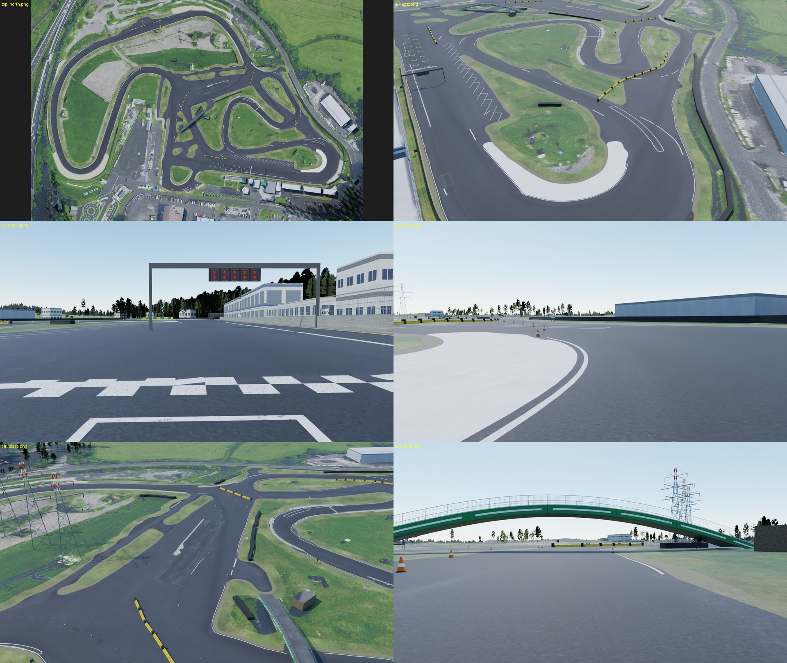
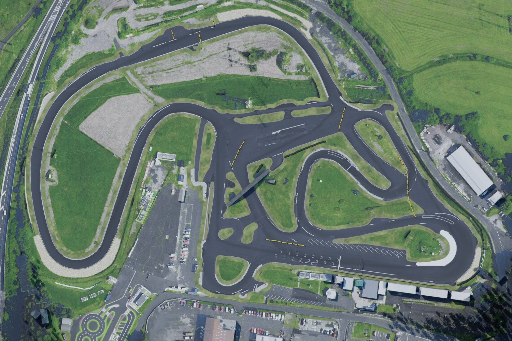
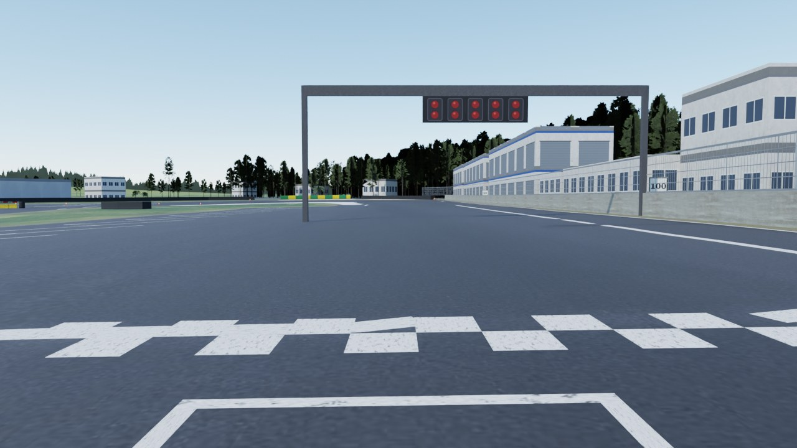
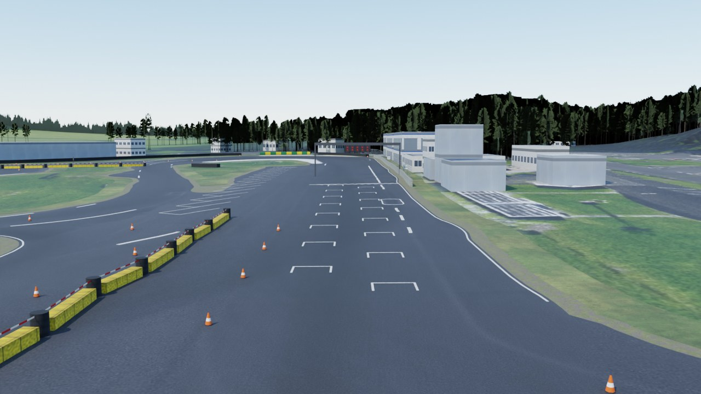
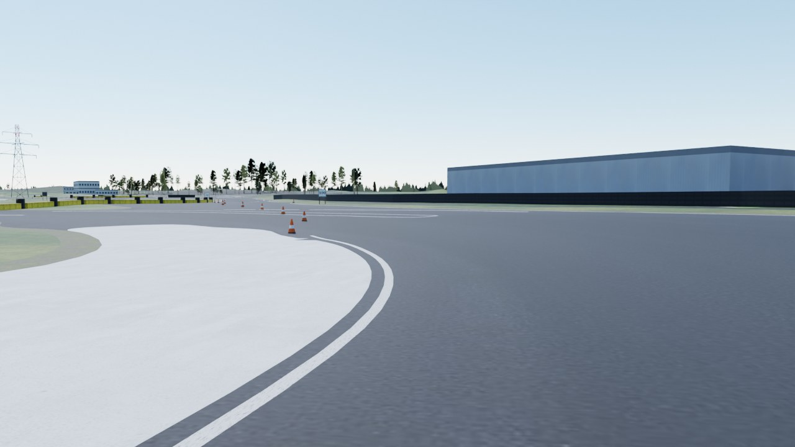
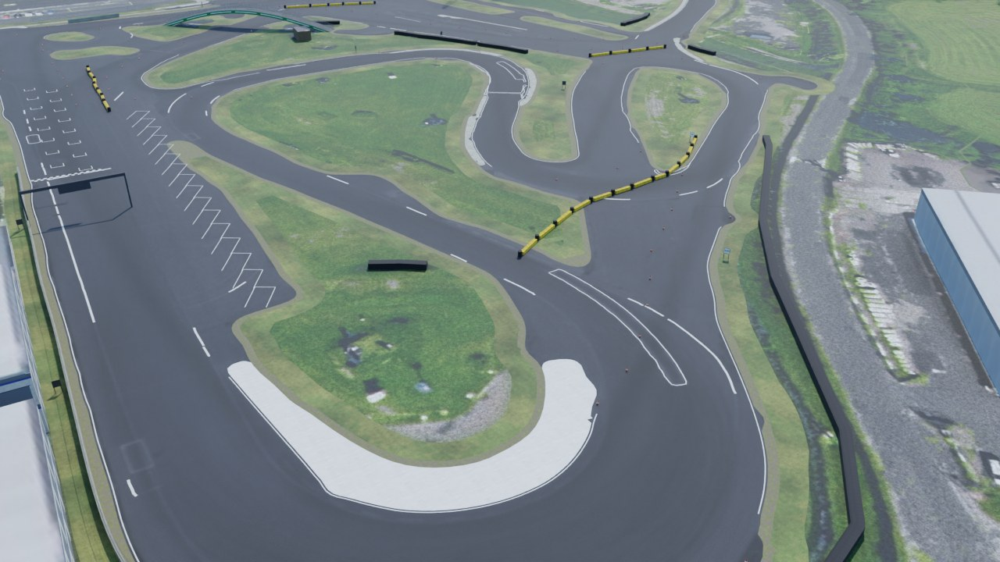
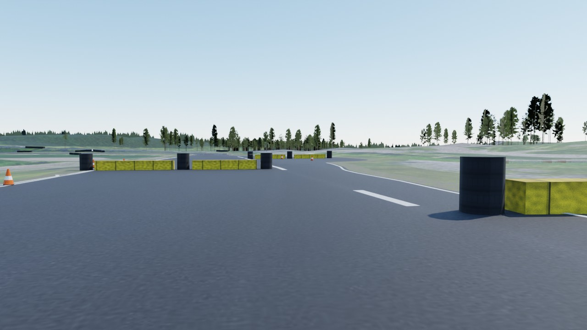
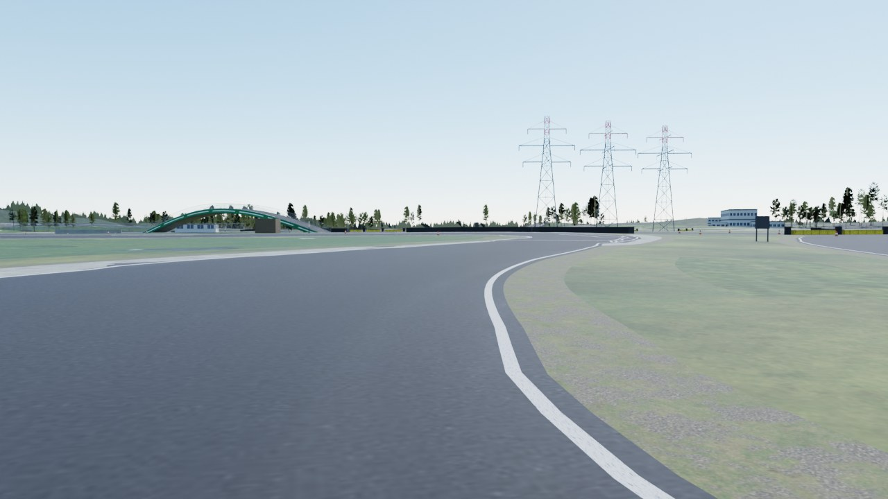
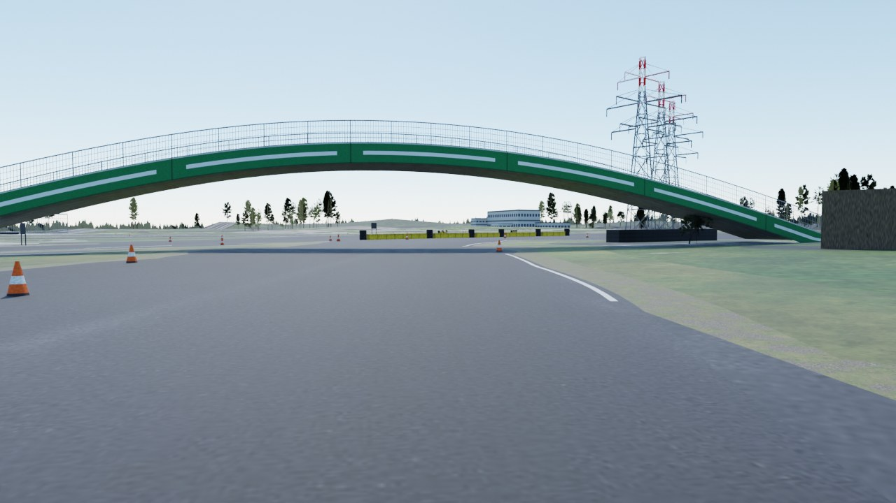
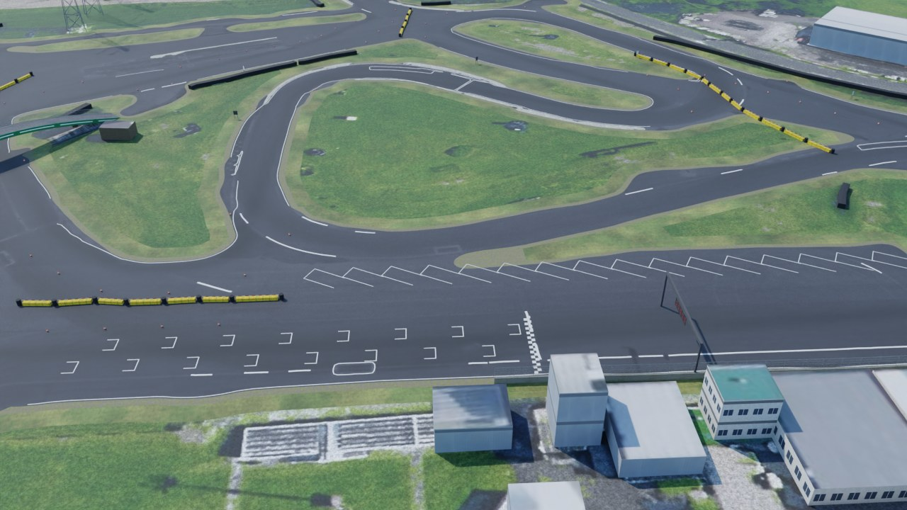
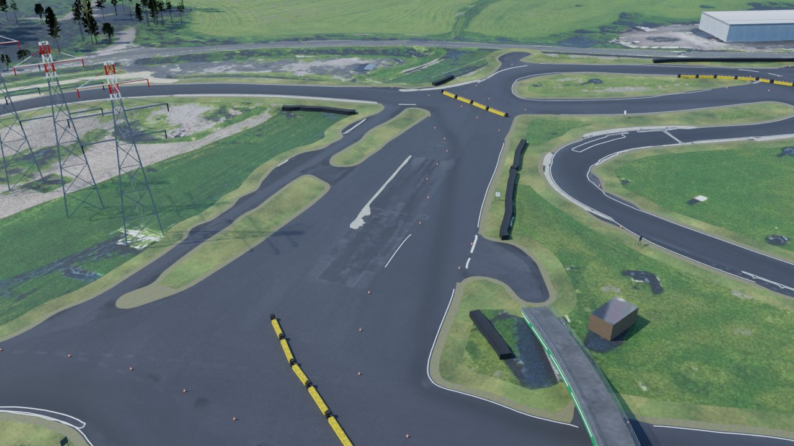
