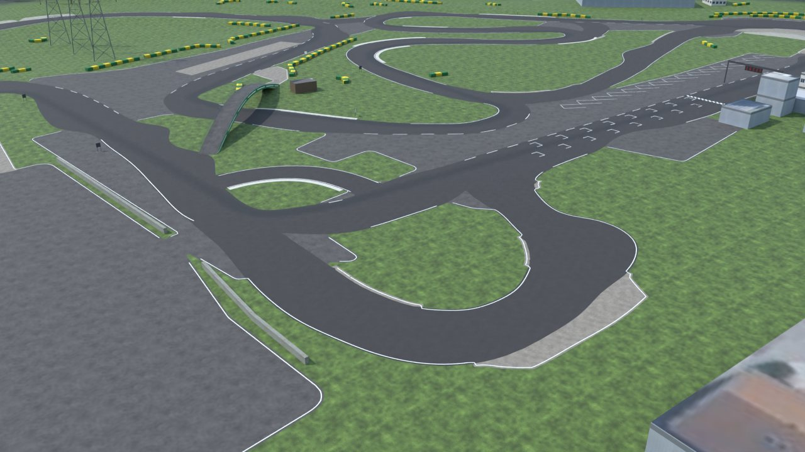
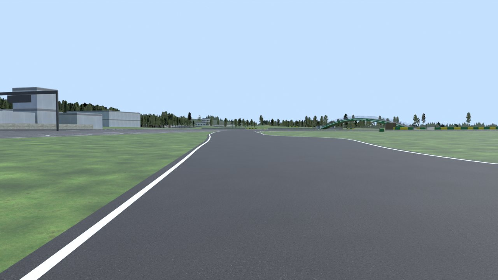
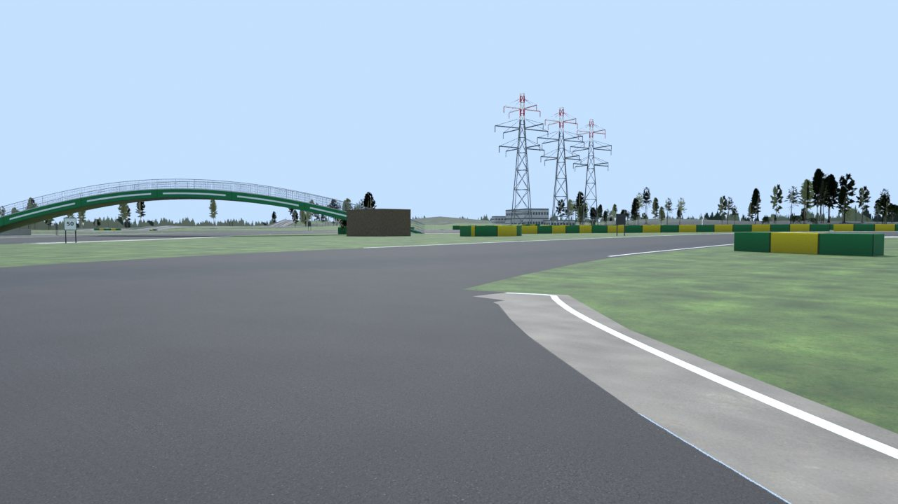
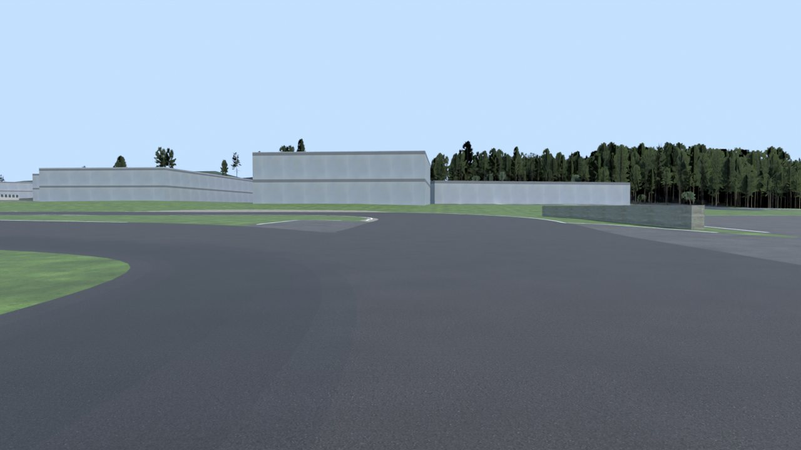
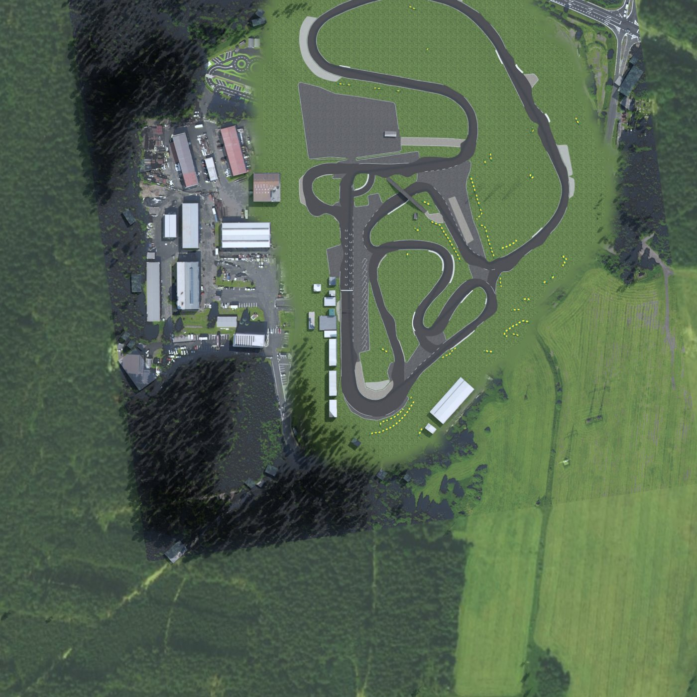

# Autodrom Sosnová for Assetto Corsa (v7.0)

Two drivable Assetto Corsa (2014) tracks of Autodrom Sosnová near Česká Lípa, Czech Republic. They are the same
place and the same model with two different laps.

| Track folder | Lap | Length |
| --- | --- | --- |
| `sosnova_v7_race` | The route of the race on 14.11.2026, under the green bridge | 1764 m |
| `sosnova_v7_standard` | The standard circuit, turns 1 to 12 | 1667 m |

**Download:** [`download/sosnova_v7.zip`](download/sosnova_v7.zip) holds both folders. Install notes are in
[`content/tracks/sosnova_v7_race/INSTALL.txt`](content/tracks/sosnova_v7_race/INSTALL.txt). Delete older
`sosnova*` folders from `content/tracks` first. The model of the standard track is a copy of the race model. It is in
the zip but not stored a second time under `content/`.

## What v7.0 is

The circuit as the aerial photo shows it, for practice before a race. The race route lies inside the standard
circuit and shares most of its asphalt with it. Version 6 measured the edges of the race lap in the photo but
drew the other roads of the standard circuit by hand with one width. In v7 the standard circuit is a second
surveyed lap (`stdlap.py`), so the return road, the link at the infield hairpin, the north junction and the
south-west loop have their real edges too, and the standard circuit can be driven as its own timed lap.

| Part | How it is made |
| --- | --- |
| Lap position and height | The route of the 14.11.2026 event on the real asphalt (`refine.py`), 1764 m anticlockwise. Heights from the lidar terrain model as a smooth surface. The site is nearly flat: 2.8 m between the highest and lowest point. The terrain model and the newer surface model agree along the lap to 5 cm. |
| Road edges | The real asphalt edges, measured in the photo at every metre and smoothed over 4 m. Width 7.8 to 18.2 m, 11.3 m on average, 17.6 m in the first turn. |
| Open sides | Where no edge lies within 13 m (a junction, the square, the start area) the lap keeps a 5 m lane and the surrounding asphalt comes from `circuit.py`. This is 27 % of the left side and 9 % of the right side. |
| Lines | A solid white line on every real edge. Dashes where the lap crosses open asphalt. No line where an edge swings into a junction. |
| Kerbs | Only where the real circuit has them (`edgescan.py`): 12 flat strips of pale concrete, 221 m. The photo shows no red and white kerbs anywhere on the lap. |
| Sand | Only where the photo shows it: 4 run-offs, 143 m along the lap, plus the pocket inside the first turn. |
| Barriers | The tyre walls traced from the photo, cut where they would cross asphalt, and the paddock wall. |
| Standard circuit | Put together from the surveyed race line and four hand-traced links, then moved onto the asphalt and measured like the race lap. Its own roads are polygons between their real edges with a smooth surface of their own. 13 concrete kerbs and 4 sand run-offs were found along it. |
| Rest of the place | Hand-traced in `circuit.py` and checked against the surveyed asphalt: the big square, the start area, the junctions, the wide outside of the first turn, the link by the bridge, the paddock and the white concrete inside the first turn. |
| Start | Chequered band, 16 grid boxes, start lights on a gantry, brake boards 150/100/50, 16 pit bays on the start area. These are additions for the game. |
| Still from the survey | The green arch bridge, buildings with their heights and photo roofs, pylons, trees at measured heights, the terrain and the distant ground photo. |
| Materials | Photo-scanned CC0 surfaces and pictures of scanned 3D trees from Poly Haven. |

The event barriers and slalom tyres of the 14.11.2026 layout are still left out.

## Rebuilding

```
pip install numpy scipy pillow opencv-python-headless shapely triangle scikit-image bpy
cd tools
# survey data, only needed when the files in source/cuzk and source/cuzk_far are missing
python3 fetch_cuzk.py --center 50.65900,14.53906 --half 320,290 --dsm
python3 fetch_cuzk.py --center 50.65900,14.53906 --half 1250,1000 --gsd 1 --dem-gsd 4 --out ../source/cuzk_far
python3 prep.py            # photo at 25 cm and first colour classes
python3 survey.py          # object heights, buildings, canopy, hard surface
python3 paint.py           # trace painted markings and barriers
python3 refine.py          # move the race lap onto the real asphalt and measure its real edges
python3 edgescan.py        # real concrete kerbs and sand run-offs along the race lap
python3 stdlap.py          # the standard circuit as a second lap
SOSNOVA_LAP=_std python3 refine.py && SOSNOVA_LAP=_std python3 edgescan.py
python3 heights.py         # smooth road surface and blended ground
SOSNOVA_LAP=_std python3 heights.py
python3 mkbuildings.py     # building footprints and heights
python3 build.py           # writes content/tracks/sosnova_v7_race and sosnova_v7_standard
python3 check.py           # validates the files the game will load
SOSNOVA_TRACK=sosnova_v7_standard python3 check.py
python3 render.py          # check renders from the spawn points, along the lap and at the bridge
```

The orthophoto files are not stored in the repository because of their size. `fetch_cuzk.py` downloads them
again. The scanned materials and the tree pictures are stored in `source/assets` (see `SOURCES.md` there).
`mktrees.py` and `tree_atlas.py` remake the tree pictures from the Poly Haven models.

## Conventions that matter

- kn5 space is right-handed with `+Y` up. A dummy matrix has rows local X, local Y, local Z, position. A car
  faces local `+Z`. `AC_TIME_n_L` is on the driver's left.
- World origin is on the start/finish line. `+Z` is the direction of travel on the start straight and `+X`
  is the driver's left. Grid dummies carry no rotation.
- Physical meshes are named `<digit><KEY>_name`, with the keys defined in `data/surfaces.ini`:
  `ROAD`, `APRON`, `KERB`, `GRASS`, `SAND`, `WALL`.
- Only the stock shaders `ksPerPixel` and `ksPerPixelAT` are used.

## Reference photos

Ground-level photos were used only to learn what things look like (colours, shapes, materials). None of them
is stored here or used as a texture.

- Driving Camp Autodrom Sosnová, track day galleries 2026: <https://www.autodrom.cz/>
- corners.cz, "Novinky na okruhu v Sosnové" (2022): <https://www.corners.cz/en/blog/novinky-na-okruhu-v-sosnove/>

## Limits

- Source accuracy is about 0.25 m in plan and 0.2 m in height. Millimetre accuracy is not possible from
  aerial survey data. No public laser scan of the track surface itself was found.
- The track was validated by reading back the built files and by renders. It was not run inside the game here.
- The standard lap's own roads lie on the ground mesh, not on a road mesh of their own. Where the standard lap leaves or joins the race lap (five places) the surface has a slight crease, up to 2.8 % change of gradient per metre. The race lap stays below 0.3 %.
- The lap edges follow the photo to about 0.5 m. The other roads and paved areas are traced by eye to about 1 m.
- The photo shows few painted lines. The white edge lines are an addition, as on the resurfaced circuit.
- The orthophoto is the current state survey edition. Anything changed on site after it was flown is not in the track.
- Rain and puddles depend on Custom Shaders Patch with RainFX and a weather script.

## Data and licence

Orthophoto: ČÚZK Ortofoto ČR. Terrain: ČÚZK DMR 5G. Surface: ČÚZK DMP 1G. All CC BY 4.0.
Materials and tree models: Poly Haven, CC0. Not affiliated with the circuit owner.

## Check renders

Rendered from the built `sosnova_v7_race.kn5` with `tools/render.py`.







