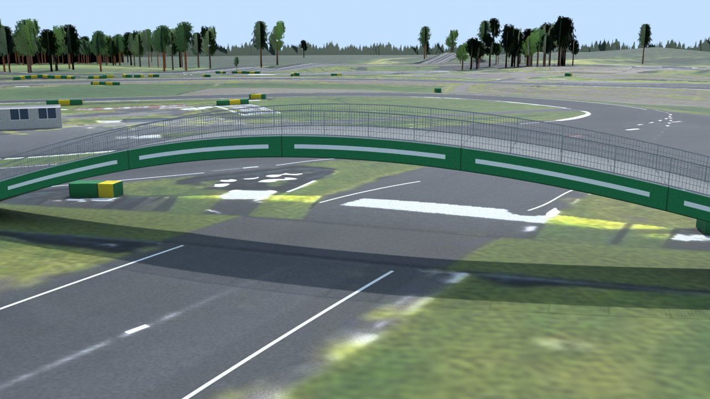

# Autodrom Sosnová for Assetto Corsa (v3.1)

A drivable Assetto Corsa (2014) copy of Autodrom Sosnová near Česká Lípa, Czech Republic, built from public
survey data: the state aerial photo and two lidar height models.

**Download:** [`download/sosnova_v3.zip`](download/sosnova_v3.zip). Install notes are in
[`content/tracks/sosnova_v3/INSTALL.txt`](content/tracks/sosnova_v3/INSTALL.txt). Delete the older `sosnova`
and `sosnova_v2` folders from `content/tracks` first.

## What v3.1 is

Version 3.1 is the circuit itself, as an exact copy of the place. The event barriers and slalom tyres of the
14.11.2026 layout are left out on purpose and come back in a later step.

| Part | How it is made |
| --- | --- |
| Ground | The real aerial photo (12.5 cm per pixel) is the base colour of all asphalt and grass, toned to game brightness. The game's multilayer shader lays sharp asphalt, grass and bare-ground detail over it, chosen per pixel by a mask. |
| Markings | Solid white lines along both edges of the lap, as on the resurfaced circuit. Other clear paint (start boxes, kerb stones) is traced from the photo. All of it is sharp geometry 2 cm above the asphalt. |
| Drivable area | All asphalt of the complex, not only the lap. The lap itself is a structured ribbon with an analytic, smooth height. |
| Bridge | The green arch bridge: 54 m long, 3.8 m wide, deck 5.2 m above the lower road at its highest, open underneath, with mesh railings. Position from the aerial photo, height from the surface model, look from the circuit's own 2026 photos. The lap passes under it and the deck is drivable. |
| Buildings | Footprints and heights from the surface model (tall, flat-topped objects), pit complex outlines measured on the photo. Every roof shows its own piece of the photo. |
| Barriers | Traced from the aerial photo (black, colour-neutral, narrow and long, standing on grass, within 35 m of the lap) and shown as the green and yellow padded modules of the 2026 photos. |
| Trees | Placed where the surface model shows canopy, at the measured height. |
| Lap | 1764 m anticlockwise, the route of the 14.11.2026 event, moved onto the real asphalt where the hand-drawn route cut corners (up to 7 m at two hairpins). 16 grid slots, 16 pit boxes, AI line, map, cameras. |
| Pylons | Three lattice power pylons north of the bridge, positions from the aerial photo. |

## Rebuilding

```
pip install numpy scipy pillow opencv-python-headless shapely triangle scikit-image bpy
cd tools
# survey data, only needed when the files in source/cuzk and source/cuzk_far are missing
python3 fetch_cuzk.py --center 50.65900,14.53906 --half 320,290 --dsm
python3 fetch_cuzk.py --center 50.65900,14.53906 --half 1250,1000 --gsd 1 --dem-gsd 4 --out ../source/cuzk_far
python3 prep.py            # photo at 25 cm and first colour classes
python3 geom.py            # centre line and widths of the lap
python3 heights.py         # smooth road surface and blended ground
python3 survey.py          # object heights, buildings, canopy, hard surface
python3 paint.py           # trace painted markings and tyre barriers
python3 refine.py          # move the lap onto the real asphalt, limit its widths to the real edges
python3 heights.py         # again, for the refined lap
python3 mkbuildings.py     # building footprints and heights
python3 build.py           # writes content/tracks/sosnova_v3
python3 check.py           # validates the files the game will load
python3 render.py          # check renders from the spawn points, along the lap and at the bridge
```

The orthophoto files are not stored in the repository because of their size. `fetch_cuzk.py` downloads them again.

## Conventions that matter

- kn5 space is right-handed with `+Y` up. A dummy matrix has rows local X, local Y, local Z, position. A car
  faces local `+Z`. `AC_TIME_n_L` is on the driver's left.
- World origin is on the start/finish line. `+Z` is the direction of travel on the start straight and `+X`
  is the driver's left. Grid dummies carry no rotation.
- Physical meshes are named `<digit><KEY>_name`, with the keys defined in `data/surfaces.ini`:
  `ROAD`, `APRON`, `KERB`, `GRASS`, `WALL`.
- The ground uses the stock `ksMultilayer` shader: `txDiffuse` is the photo, `txMask` selects the detail
  layers `txDetailR/G/B` (asphalt, grass, bare ground), tiled by `multR/G/B`. `txDetailA` is black, so the
  mask needs no alpha channel.

## Reference photos

Ground-level photos were used only to learn what things look like (colours, shapes, materials). None of them
is stored here or used as a texture.

- Driving Camp Autodrom Sosnová, track day galleries 2026: <https://www.autodrom.cz/>
- corners.cz, "Novinky na okruhu v Sosnové" (2022): <https://www.corners.cz/en/blog/novinky-na-okruhu-v-sosnove/>

## Limits

- Source accuracy is about 0.25 m in plan and 0.2 m in height. Millimetre accuracy is not possible from
  aerial survey data.
- The track was validated by reading back the built files and by renders. It was not run inside the game here.
- Faint, worn lines stay as they are in the photo. Only clear paint is traced into sharp geometry.
- The photo carries the shadows and parked vehicles of the day it was taken.
- Rain and puddles depend on Custom Shaders Patch with RainFX and a weather script.

## Data and licence

Orthophoto: ČÚZK Ortofoto ČR. Terrain: ČÚZK DMR 5G. Surface: ČÚZK DMP 1G. All CC BY 4.0.
Detail and object textures are generated by the tools. Not affiliated with the circuit owner.

## Check renders

Rendered from the built `sosnova_v3.kn5` with `tools/render.py`.





