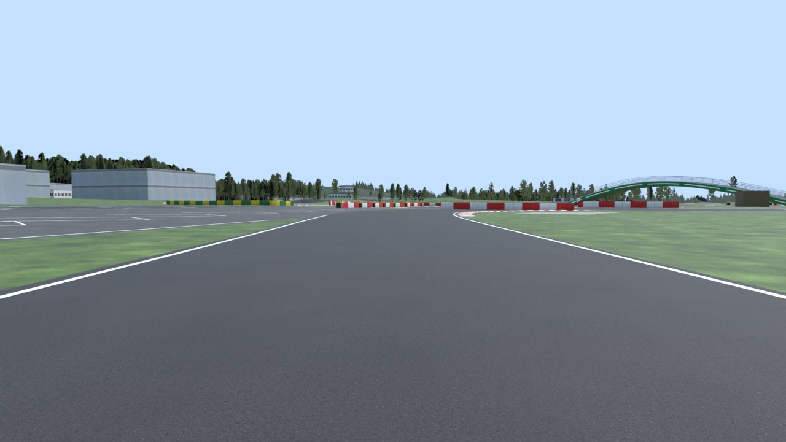
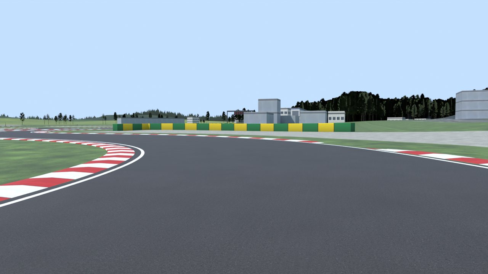
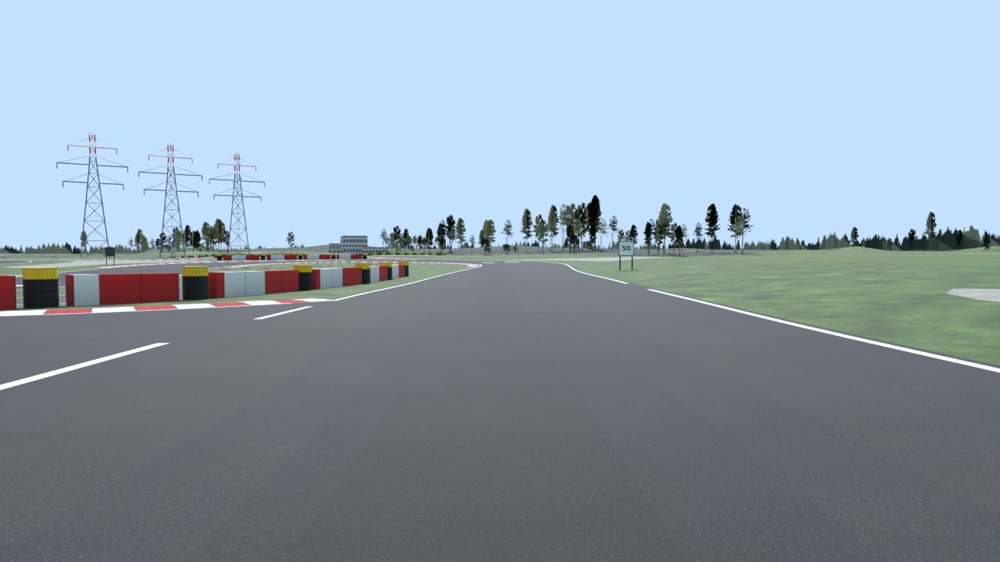
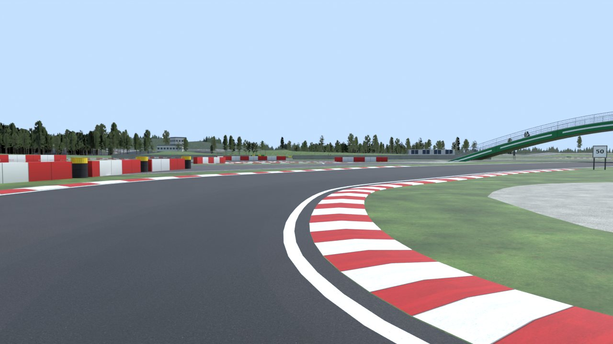

# Autodrom Sosnová for Assetto Corsa (v9.6)

A drivable Assetto Corsa (2014) track based on Autodrom Sosnová near Česká Lípa, Czech Republic.

**Download:** [`download/sosnova_v9.zip`](download/sosnova_v9.zip). Install notes are in
[`content/tracks/sosnova_v9/INSTALL.txt`](content/tracks/sosnova_v9/INSTALL.txt). Delete older `sosnova*`
folders from `content/tracks` first.

## What v9.6 is

The clean racetrack of version 5, with every other road of the circuit connected to it. Versions 6 to 8 tried
to follow the aerial photo edge by edge. The owner found them messy and pointed at a picture of the version 5
track: that one, with the loose road pieces connected. So v9 goes back to the version 5 design
(`tools/design.py`): one road width, a grass verge, kerbs and gravel traps on the corners. The roads the race
lap does not use are traced by hand (`tools/circuit.py`) and each runs from the lap to the lap.

| Part | How it is made |
| --- | --- |
| Lap position and height | From the survey: the route of the 14.11.2026 event moved onto the real asphalt (`refine.py`), 1764 m anticlockwise, heights from the lidar terrain model as a smooth analytic surface. |
| Road | 9 m wide everywhere. White lines on both edges, parallel all the way round, dashed along the pit apron. A rubbered racing line in three gentle steps of darker asphalt. |
| Verge | A 4 m grass strip along both sides of the lap, except where the pit apron joins. |
| Kerbs | Red and white, 1 m wide, on the inside of every corner tighter than 60 m radius and on the outside of the exit of corners tighter than 28 m. 27 kerbs, 1175 m. |
| Gravel traps | One on the outside of every corner tighter than 45 m radius, behind the verge, 11 m deep with tapered ends, and a padded barrier along its back. Physical surface `SAND`. |
| Pit apron | A clean slab 20 m deep beside the start straight with 16 painted bays. |
| Start | Chequered band, 16 grid boxes, start lights on a gantry, brake boards 150/100/50. |
| Connected roads | Five roads, 457 m, each from the lap to the lap, so none ends in the grass: the return road from turn 1 into the infield loop, the link at the infield hairpin, the link across the north junction, the loop south-west of the start (all 9 m wide) and the short link by the bridge (8 m). From 9.1 they are finished like the lap by the same rules: dark asphalt, two parallel white lines, 12 raised red and white kerbs (374 m) on the inside of their bends and the outside of tight exits, a 4 m grass verge on both sides, a gravel trap with a padded barrier on the outside of their bends, and rows of mesh vertices along them for an even surface. |
| Turn 1 | From 9.2 the first turn has its real width, about 17 m. The owner drew the line he wanted on a render. The asphalt outside the 9 m lap is added up to one smooth outer curve (`circuit.t1_lane`): it follows the outer asphalt edge measured in the orthophoto and then sweeps into the north edge of the return road, as the painted limit of the real turn does. Same dark asphalt, a white line along the outer edge, a dashed line where that curve crosses the race route, the gravel trap and barrier moved out behind it. |
| Race layout (9.3, 9.5) | The 33 yellow dots of the organiser's map (registered on the photo, `tr.cones_en`) are grouped into 7 rows. Each row is a closed line: a tyre barrel with a yellow top at every dot, red and white plastic barriers between the barrels (26 pieces, 108 m) and red and white tape along the top (139 m). Three rows form the chicane on the back straight, the other four close the roads and areas the race does not use. Rows of barricades close the 10 remaining unused road mouths that no organiser row covers (124 m). The racing line is kept 1.4 m clear of every barrel. |
| Route guidance (9.6) | The owner drew a line on the organiser's map, on the left of the east leg from the infield loop down to the return road, and asked to see clearly where to go. Eight more tyre barrels (`circuit.EXTRA_DOTS`) continue the organiser's row there in both directions, with barriers and tape like every row, so after turn 1 the only way is north. Pairs of white arrows are painted on the lap 14 m before each of 11 junctions, pointing along the race route. |
| Timing | Start/finish gate at point 0 and one sector gate in the middle of the lap, each 14 m wide. The game times every lap and shows two sectors. |
| Road surface (9.4) | The other roads have a smooth surface of their own, made like the lap's: a height profile along the centre line and a gentle cross-fall, smoothed along the road. Near the lap they continue the lap's own surface outwards. Worst change of gradient 1.6 % per metre, before 4 %. The lap itself is below 0.3 %. All asphalt has the same grip now. |
| Junctions | Where a road joins the lap, the lap's kerb stops and its edge line turns into dashes across the mouth. |
| Paved areas | Clean polygons with rounded corners and a white line along every free edge: the big square, the start area, the junction fans and the paddock. They stay behind the 4 m grass verge of the lap and of every road. |
| Concrete and gravel | The white apron inside the east hairpin with its gravel pocket, the skid pad on the square, the slab at the foot of the bridge, the paddock lane and the lay-by on the north straight. |
| Seams | Mesh edges follow every seam between road, apron and concrete, so no seam is jagged. |
| Barriers | Padded barriers behind the gravel traps, and the concrete wall between the paddock and the west leg. A barrier is cut where it would cross asphalt. |
| Still from the survey | The green arch bridge, buildings with their heights and photo roofs, pylons, trees at measured heights, the terrain and the distant ground photo. |
| Materials | Photo-scanned CC0 surfaces and pictures of scanned 3D trees from Poly Haven. |

The positions of the rows come from the organiser's map. What each row is made of (barrels, barriers, tape) follows the owner's request. The barricades across the remaining unused roads are an addition.

## Rebuilding

```
pip install numpy scipy pillow opencv-python-headless shapely triangle scikit-image bpy
cd tools
# survey data, only needed when the files in source/cuzk and source/cuzk_far are missing
python3 fetch_cuzk.py --center 50.65900,14.53906 --half 320,290 --dsm
python3 fetch_cuzk.py --center 50.65900,14.53906 --half 1250,1000 --gsd 1 --dem-gsd 4 --out ../source/cuzk_far
python3 prep.py            # photo at 25 cm and first colour classes
python3 survey.py          # object heights, buildings, canopy, hard surface
python3 paint.py           # trace painted markings and barriers
python3 refine.py          # move the lap onto the real asphalt, limit its widths to the real edges
python3 heights.py         # smooth road surface and blended ground
python3 mkbuildings.py     # building footprints and heights
python3 build.py           # writes content/tracks/sosnova_v9 (the original circuit comes from circuit.py)
python3 check.py           # validates the files the game will load
python3 render.py          # check renders from the spawn points, along the lap and at the bridge
```

The orthophoto files are not stored in the repository because of their size. `fetch_cuzk.py` downloads them
again. The scanned materials and the tree pictures are stored in `source/assets` (see `SOURCES.md` there).
`mktrees.py` and `tree_atlas.py` remake the tree pictures from the Poly Haven models.

## Conventions that matter

- kn5 space is right-handed with `+Y` up. A dummy matrix has rows local X, local Y, local Z, position. A car
  faces local `+Z`. `AC_TIME_n_L` is on the driver's left.
- World origin is on the start/finish line. `+Z` is the direction of travel on the start straight and `+X`
  is the driver's left. Grid dummies carry no rotation.
- Physical meshes are named `<digit><KEY>_name`, with the keys defined in `data/surfaces.ini`:
  `ROAD`, `APRON`, `KERB`, `GRASS`, `SAND`, `WALL`.
- Only the stock shaders `ksPerPixel` and `ksPerPixelAT` are used.

## Reference photos

Ground-level photos were used only to learn what things look like (colours, shapes, materials). None of them
is stored here or used as a texture.

- Driving Camp Autodrom Sosnová, track day galleries 2026: <https://www.autodrom.cz/>
- corners.cz, "Novinky na okruhu v Sosnové" (2022): <https://www.corners.cz/en/blog/novinky-na-okruhu-v-sosnove/>

## Limits

- Source accuracy is about 0.25 m in plan and 0.2 m in height. Millimetre accuracy is not possible from
  aerial survey data. No public laser scan of the track surface itself was found.
- The track was validated by reading back the built files and by renders. It was not run inside the game here.
- The road width, verges, kerbs, gravel traps, lines and the pit apron are a design, not a copy of the real circuit.
- The other roads and paved areas are in their real places, traced by eye to about 1 m. Their widths, lines and kerbs are a design.
- The real asphalt is wider than 9 m in places. Only the first turn has its real width. Its outer curve uses `source/work/centerline_std.json`, the standard lap measured for version 7.
- `check.py` runs 47 checks from 9.4. Ten new ones cover each connected road (paved over its whole width, even), the road kerbs, the barricades (clear of the lap), every tyre stack (on the ground, racing line and free road width past it).
- The ground mesh builder merges outline points closer than 10 cm and splits segments at vertices lying on them.
- Rain and puddles depend on Custom Shaders Patch with RainFX and a weather script.

## Data and licence

Orthophoto: ČÚZK Ortofoto ČR. Terrain: ČÚZK DMR 5G. Surface: ČÚZK DMP 1G. All CC BY 4.0.
Materials and tree models: Poly Haven, CC0. Not affiliated with the circuit owner.

## Check renders

Rendered from the built `sosnova_v9.kn5` with `tools/render.py`.










