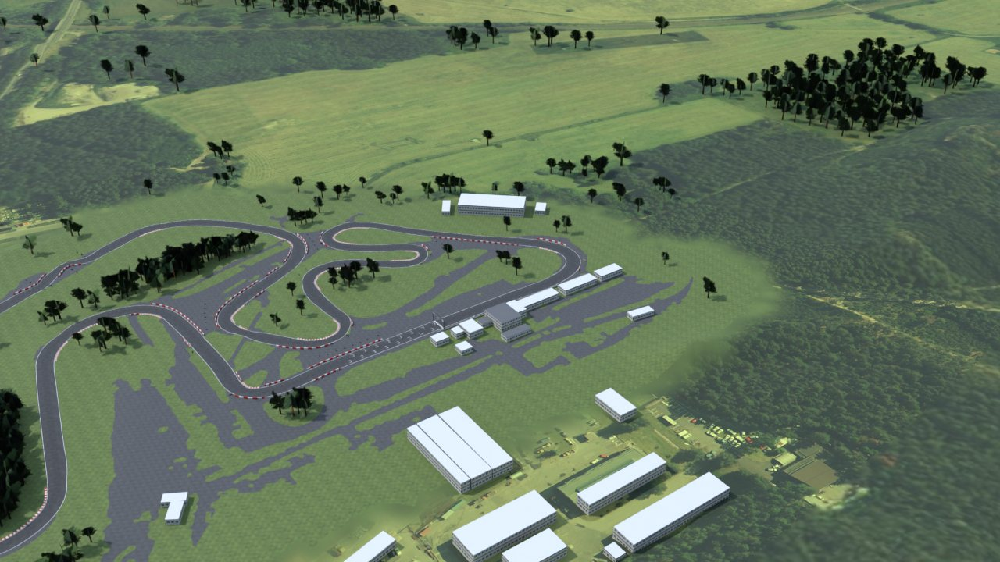

# Autodrom Sosnová for Assetto Corsa (v2.0)

A drivable Assetto Corsa (2014) track of Autodrom Sosnová near Česká Lípa, Czech Republic, in the combined
layout used for the event of 14.11.2026. Version 2.0 is a complete rebuild.

**Download:** [`download/sosnova_v2.zip`](download/sosnova_v2.zip). Install notes are in
[`content/tracks/sosnova_v2/INSTALL.txt`](content/tracks/sosnova_v2/INSTALL.txt). Delete the old `sosnova`
folder from `content/tracks` before installing.

## What changed in v2.0

| v1 problem reported from the game | v2.0 |
| --- | --- |
| Cars face backwards | The world is built around the start: `+Z` is the start straight. Grid dummies carry no rotation at all, and the validator checks every spawn point against the AI line. New folder name so an old install cannot be loaded by mistake. |
| Road is uneven | The road is an analytic surface: a smoothed centre height profile plus a smoothed cross-fall, sampled every metre. The ground is blended into it. Largest change of gradient is 0.16 % per metre. |
| Geometry is a mess | One structured road ribbon with the edge lines inside the mesh, a constrained triangulation for aprons and grass that shares every road edge vertex, kerbs and barriers generated from the same stations. |
| Graphics | Tiled asphalt and grass near the track instead of a stretched aerial photo, painted start line and grid boxes, kerbs, barrier modules, pit complex, trees, signs. Brightness matched to stock tracks. |

## Contents

- `content/tracks/sosnova_v2/` is the finished track folder (kn5, AI line, data, UI, CSP config).
- `tools/` rebuilds it from the survey data.
- `source/` holds the survey data and the intermediate centre line.

## Rebuilding

```
pip install numpy scipy pillow opencv-python-headless shapely triangle bpy
cd tools
# survey data, only needed when source/cuzk/ortho.png or source/cuzk_far/ortho.png is missing
python3 fetch_cuzk.py --center 50.65900,14.53906 --half 320,290
python3 fetch_cuzk.py --center 50.65900,14.53906 --half 1250,1000 --gsd 1 --dem-gsd 4 --out ../source/cuzk_far
python3 prep.py            # classify the orthophoto: asphalt, trees, roofs
python3 geom.py            # centre line, widths, slalom points
python3 heights.py         # smooth road surface and blended ground
python3 mkbuildings.py     # building footprints
python3 build.py           # writes content/tracks/sosnova_v2
python3 check.py           # validates the files the game will load
python3 render.py          # check renders from the spawn points and along the lap
```

The orthophoto files are not stored in the repository because of their size. `fetch_cuzk.py` downloads them again.

## Conventions that matter

- kn5 space is right-handed with `+Y` up. A dummy matrix has rows local X, local Y, local Z, position. A car
  faces local `+Z`. `AC_TIME_n_L` is on the driver's left.
- World origin is on the start/finish line. `+Z` is the direction of travel on the start straight and `+X`
  is the driver's left.
- Physical meshes are named `<digit><KEY>_name`, with the keys defined in `data/surfaces.ini`:
  `ROAD`, `APRON`, `KERB`, `GRASS`, `WALL`.
- `ai/fast_lane.ai` has one point per metre and point 0 lies on the start line.

## Limits

- Source accuracy is about 0.25 m in plan and 0.2 m in height. Millimetre accuracy is not possible from
  aerial survey data.
- The track was validated by reading back the built files and by renders. It was not run inside the game here.
- Rain, wet grip and puddles depend on Custom Shaders Patch with RainFX and a weather script.

## Data and licence

Orthophoto: ČÚZK Ortofoto ČR. Terrain: ČÚZK DMR 5G. Both CC BY 4.0. All textures are generated by the tools.
Not affiliated with the circuit owner.

## Check renders

Rendered from the built `sosnova_v2.kn5` with `tools/render.py`. The first one is the driver's eye on pole position.



