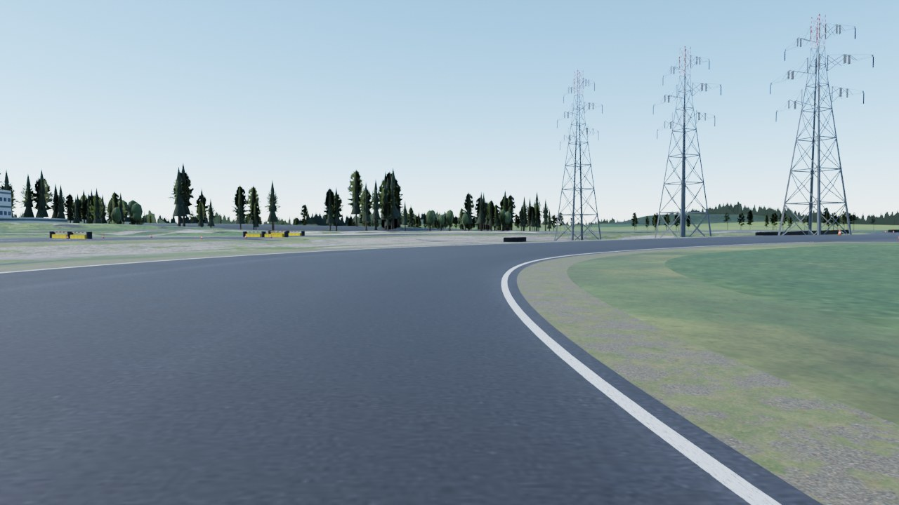
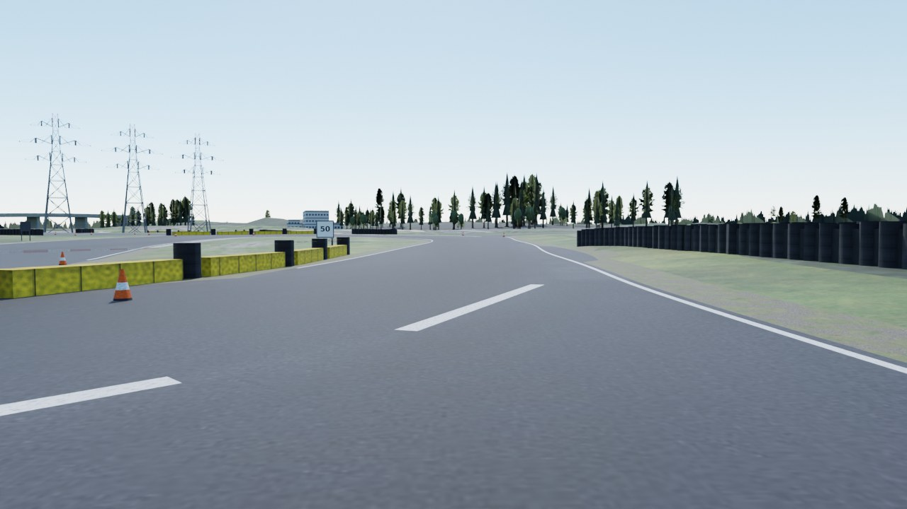
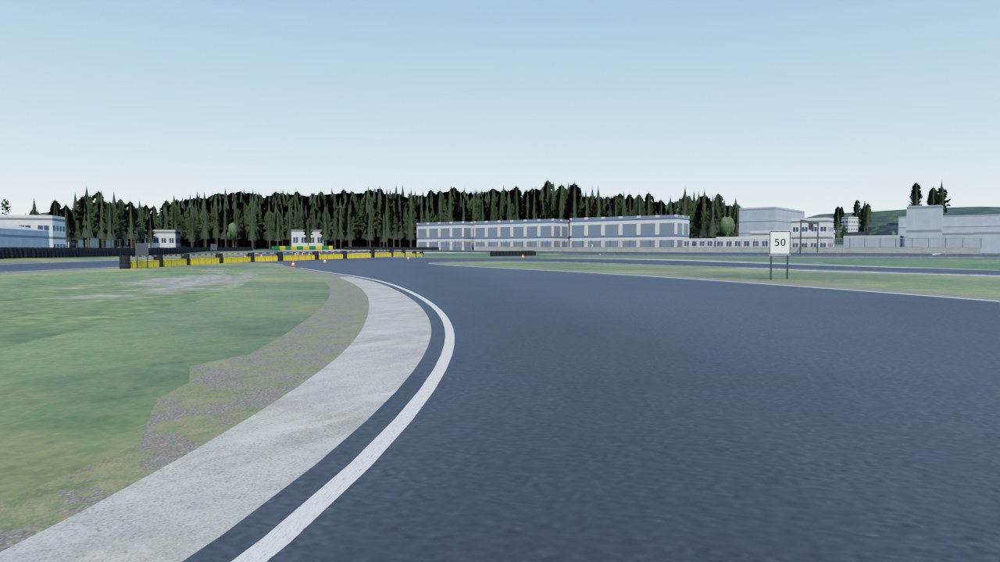
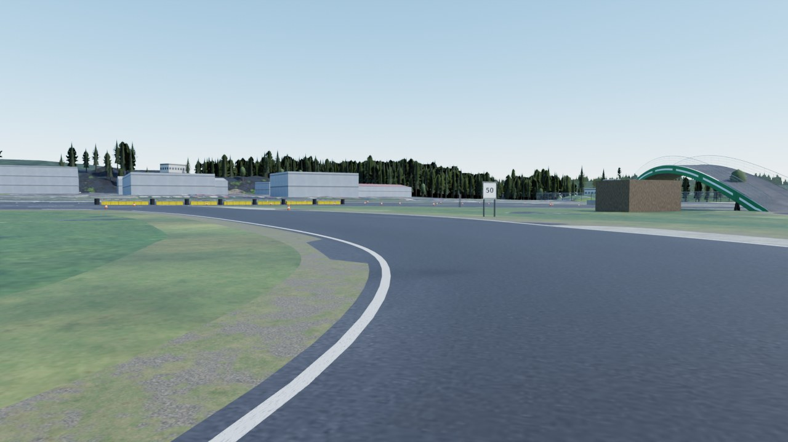
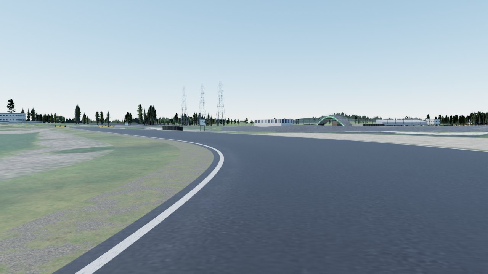
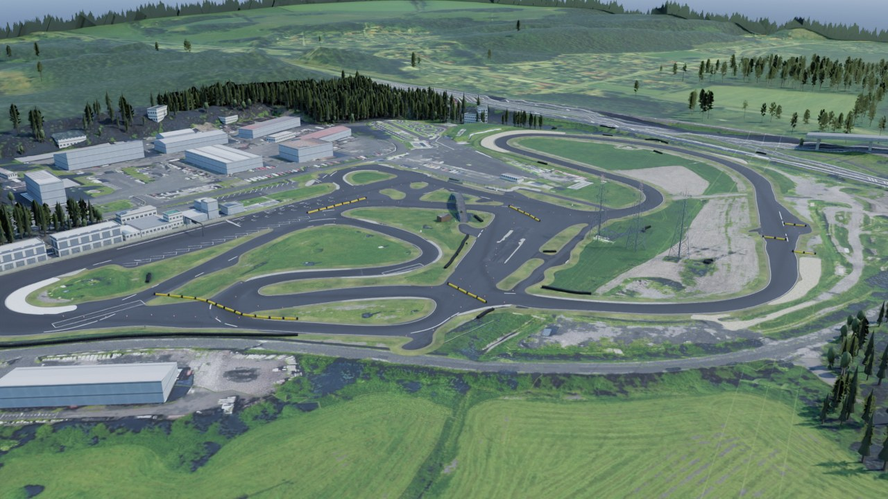
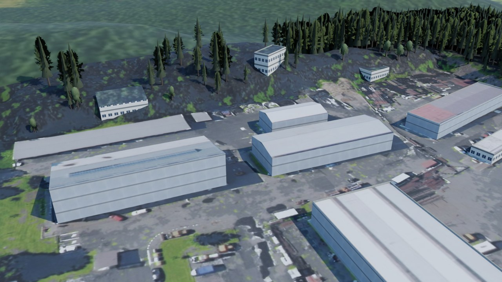
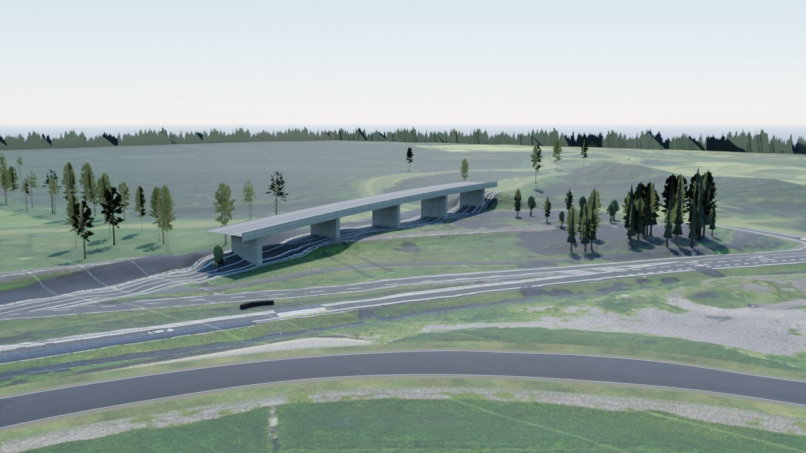

# Autodrom Sosnová for Assetto Corsa (v14.0)

A drivable Assetto Corsa (2014) track of Autodrom Sosnová near Česká Lípa, Czech Republic, as the place really is.

**Download:** [`download/sosnova_v9.zip`](download/sosnova_v9.zip). Install notes are in
[`content/tracks/sosnova_v9/INSTALL.txt`](content/tracks/sosnova_v9/INSTALL.txt). Delete older `sosnova*`
folders from `content/tracks` first. The folder keeps the name `sosnova_v9`; the game shows it as
"Autodrom Sosnová v14.0".

## What v14.0 is

The owner called 13.1 perfect and asked for everything in 3D. The track, its edges and its surface are unchanged.
What was a flat picture or a plain box is now a solid body (`tools/solid.py`):

| Part | How it is made |
| --- | --- |
| Trees | Each of the 2,349 trees near the track has a trunk (a tapering six-sided column) and a canopy with volume: four overlapping cones for a conifer, two uneven rounded bodies for a broadleaf tree, 180,000 triangles in all. Three crossed pictures of the real tree (two before) stand around the body and give it its fine outline. Trees beyond the site keep two crossed pictures. |
| Tyre walls | The 22 real tyre walls are rows of single round stacks, four tyres high, each with its hole, two rows deep where the wall is wide: 1,091 stacks. A plain dark core inside the stacks is what a car hits, so the collision shape stays simple. |
| Power pylons | Square lattice towers that narrow to the top, with three pairs of cross-arms and the red and white marking, instead of two crossed pictures. |
| Fences | A steel post every 2.5 m (72 posts). |
| Flat roofs | On buildings at least 6 m wide the walls rise 35 cm above the roof as a parapet. |
| Grass | The Custom Shaders Patch settings now name the real grass materials, so its 3D grass grows on all the grass of the circuit, and its rain on all the asphalt. Without the patch the grass is a flat photo texture. |

The model has 473,000 triangles now (243,000 before).

## Clean lines: what v13.1 did

Version 13.1 answers "too wobbly, make it a more perfect line". The outline of version 12 came from a 25 cm mask
and kept its wiggle: the edge of the lap moved against the centre line by up to 36 cm from one metre to the next.
Now (`tools/realmap.py`):

| Part | How it is made |
| --- | --- |
| Edges of the lap | The distance from the centre line to the real asphalt edge is cleaned along the lap (median over 7 m, then a 5 m Gaussian, per stretch with a real edge), and smoothed once more at the end with nothing after it that could put a kink back. The largest bend of an edge against the centre line is now 6.7 cm from one metre to the next; the median is 0.4 cm. |
| Paving beside a real edge | Rebuilt from those widths (`corridor`): the lap strip, a concrete strip of one even width where the photo shows one, and nothing else for 3.5 m outside. So the asphalt ends exactly on the clean line. |
| The rest of the outline | Smoothed over 3 m along its length with a filter that does not pull corners inwards (2G - GG instead of a plain Gaussian). |
| Paint | A traced line that stays within 25 cm of the straight line between its ends is drawn straight, any other as an even curve. A traced outline counts as a painted box only if it fills a rectangle at least 2 m wide; it is then drawn as a true rectangle (3 boxes). Lines that repeat the edge line within 2.2 m are left out. |
| Tyre walls | The traced lines are smoothed, with their ends fixed. |

The clean edge stays close to the photo: 95 % of it within 0.5 m of the smoothed outline of the mask, median 3 cm.

## Landscape and buildings: what v13.0 did

Version 13 answers the owner's request to scan the whole place, landscape and buildings included. The road was
already the real one (version 12, below). Now everything around it comes from the airborne laser scan of the Czech
state survey as well:

| Part | How it is made |
| --- | --- |
| Landscape | `tools/heights.py`. Away from the paving the ground is the laser-scanned terrain model (DMR 5G, 1 m) itself, smoothed only by 0.7 m against its noise: banks, ditches and mounds are there. Within 3 m of any paving the ground stays the even surface that carries the road; by 12 m it is all terrain. The ground mesh is a 4 m grid near the track and 8 m over the rest of the site, with a 2.5 m grid on top wherever the terrain is not smooth (8,500 extra points). `check.py` compares the built ground with the terrain model at 6,500 points away from the paving: 7 cm rms, 99 % within 28 cm. The far terrain (2.5 x 2 km) has a 25 m grid now. |
| Buildings | `tools/mkbuildings.py`. The footprints are moved to where the surface model (DMP 1G, 0.5 m) puts the walls, and every roof gets the shape the model shows: the heights inside the footprint are averaged along the building and the profile across it decides between flat, single-pitch and gable. 45 buildings: 4 gable roofs, 4 single-pitch, 37 flat. Each roof carries its own piece of the aerial photo. `check.py` compares the roof heights with the surface model: 36 cm median difference. |
| Motorway viaduct | The deck behind the west loop, read row by row from the surface model: 146 m inside the site, 16 m wide, up to 12 m above the ground, on 5 piers, with the photo of the carriageway on top. |
| Trees | As before: every tree stands where the canopy model shows one, at its measured height (2,349 near the track, 550 further out). |

What a laser scan from the air cannot give is listed under Limits.

## The road: what v12.0 did

The owner asked for the exact original track, with the surface of version 11 and with barriers, started from
scratch. So the designed racetrack of versions 9 to 11 (one 9 m road, grass verges, red and white kerbs, gravel
traps on every corner) is gone. Version 12 takes the shape of everything from the 12.5 cm aerial photo of the
Czech state survey.

| Part | How it is made |
| --- | --- |
| The paved outline | `tools/realmap.py`. The hard-surface mask of the photo is cut to the circuit (a loose hand-traced boundary), cleaned of cars, paint and shadows, and its edge is smoothed over 1.6 m, once more after the concrete strips are added. The result is one outline of everything that is paved: 32,200 m2 with 13 grass islands. `check.py` compares the built surface with it at 55,000 points; one differs. |
| The lap | The route of the race of 14.11.2026, 1764 m anticlockwise, under the green bridge. Its half widths are the distance from the centre line to the real asphalt edge on each side: 7.5 m wide at the narrowest, 20.1 m in turn 1, 11.4 m on average. Where the asphalt runs on (junctions, the big square, the start area) the lap keeps a strip of its own, 5.5 m to that side, and the rest is the asphalt beside it. |
| Surface of the lap | As in 11.0: one texture for every 28 m, baked from the photo of exactly that piece (light and dark pattern of the real asphalt), over a close-up scan of asphalt, with the rubbered line on top. Wide pieces get a wider texture. |
| Surface beside the lap | New: the asphalt off the lap is cut into 40 m squares, each with its own texture baked the same way from the photo. The lap strip and the asphalt beside it meet in the same plane (largest difference 12 mm at 35 cm out). |
| Concrete | The real kerbs of Sosnová are flat strips of grey concrete along the asphalt edge. They are found in the photo (bright patches traced by `paint.py`, and pale colourless ground right outside the asphalt edge) and built as part of the surface, 960 m2 with the white pad on the inside of turn 1. Physical surface `APRON`. There are no red and white kerbs any more. |
| Sand | Only where the photo shows it: outside turn 1 and at both ends of the west loop, 1,700 m2. Physical surface `SAND`. |
| Barriers | The tyre walls traced from the photo, plus three hand-traced lines where the tracing left gaps (the wall along the east side, the white barrier and the tyres outside turn 1): 27 lines, 475 m built. With the wall along the pit buildings and the paddock wall, both with a wire fence. |
| Paint | The lines and start boxes of the real asphalt, traced from the photo (54 lines, 3 boxes). A white line runs along every real edge of the lap. It stops 2 m short of the places where the asphalt runs on. |
| Around the track | The grass tiles keep the real photo away from the asphalt: the paddock, the yards, paths and bare earth look as they are. Only within 4 m of the asphalt the photo is filled with grass colour, so paint and cars do not bleed into the verge. |
| Race layout | Unchanged from 9.5 and 9.6: tyre stacks at the organiser's 33 yellow dots and at 8 points of the line the owner drew, yellow bags and tape along the 7 rows. Cones now stand every 8 m on both sides of the lap strip where it crosses open asphalt (90 cones), so the route can be seen across the big square. |
| Heights | The lap is a smooth analytic surface fitted to the lidar terrain (range 2.8 m). The asphalt beside it continues the plane of the lap for 1.5 m and turns into the terrain over the next 4.5 m. Small bumps of the terrain model are relaxed. |
| Still from the survey | The green arch bridge, the pylons and the distant ground photo. |

## Rebuilding

```
pip install numpy scipy pillow opencv-python-headless shapely triangle scikit-image bpy
cd tools
# survey data, only needed when the files in source/cuzk and source/cuzk_far are missing
python3 fetch_cuzk.py --center 50.65900,14.53906 --half 320,290 --dsm
python3 fetch_cuzk.py --center 50.65900,14.53906 --half 1250,1000 --gsd 1 --dem-gsd 4 --out ../source/cuzk_far
python3 prep.py            # photo at 25 cm and first colour classes
python3 survey.py          # object heights, buildings, canopy, hard surface
python3 paint.py           # trace painted markings and barriers
python3 refine.py          # move the route of the race onto the real asphalt (centre line)
python3 realmap.py         # the real paved outline, concrete, sand, barriers, and the real widths of the lap
python3 heights.py         # smooth road surface and blended ground
python3 mkbuildings.py     # building footprints and heights
python3 build.py           # writes content/tracks/sosnova_v9
python3 check.py           # validates the files the game will load
python3 render.py          # check renders from the spawn points, along the lap, from the air
```

The orthophoto files are not stored in the repository because of their size. `fetch_cuzk.py` downloads them
again. The build needs them. The scanned materials and the tree pictures are stored in `source/assets` (see
`SOURCES.md` there). `mktrees.py` and `tree_atlas.py` remake the tree pictures from the Poly Haven models.

## Conventions that matter

- kn5 space is right-handed with `+Y` up. A dummy matrix has rows local X, local Y, local Z, position. A car
  faces local `+Z`. `AC_TIME_n_L` is on the driver's left.
- World origin is on the start/finish line. `+Z` is the direction of travel on the start straight and `+X`
  is the driver's left. Grid dummies carry no rotation.
- Physical meshes are named `<digit><KEY>_name`, with the keys defined in `data/surfaces.ini`:
  `ROAD`, `APRON`, `KERB`, `GRASS`, `SAND`, `WALL`.
- Only the stock shaders `ksPerPixel` and `ksPerPixelAT` are used.

## Reference photos

Ground-level photos were used only to learn what things look like (colours, shapes, materials). None of them
is stored here or used as a texture.

- Driving Camp Autodrom Sosnová, track day galleries 2026: <https://www.autodrom.cz/>
- corners.cz, "Novinky na okruhu v Sosnové" (2022): <https://www.corners.cz/en/blog/novinky-na-okruhu-v-sosnove/>

## Limits

- The track was validated by reading back the built files (`check.py`, 51 checks) and by renders. It was not run
  inside the game here.
- Source accuracy is about 0.25 m in plan and 0.2 m in height. The asphalt edge comes from a 25 cm mask and is
  smoothed; it agrees with the edge survey of version 8 to 0.15 m in the median. No laser scan of the surface exists
  in public data.
- The photo is one day in the life of the circuit. Cars, cones and tyre stacks that stood on the asphalt that day
  are removed. Tyre walls may stand elsewhere today.
- Under the overpass the photo shows the deck and its shadow, not the road. There the road is 9.6 m wide by
  assumption.
- In a few places the centre line of the race route runs closer than 2.5 m to the real edge. There the lap strip is
  held at 2.5 m to that side.
- The edges are clean curves fitted to the photo, not the photo's edge pixel by pixel: up to about 0.5 m from it
  in places.
- The white edge line is drawn along every real edge. The real circuit has such lines in most places, not all.
- The concrete strips are flat. Real ones may stand a centimetre or two proud.
- The asphalt beside the lap is less even than the lap: its gradient changes by up to 4.2 % per metre where two
  cambered pieces of the lap lie side by side, a crease like a road crown (the lap stays below 0.6).
- The preview pictures are renders with their own sky and light. The game lights the track itself, so it will
  look different there.
- The photo is 12.5 cm per pixel. It gives the real pattern of the asphalt and the grass, not their grain. From
  close up the grass tiles (10 cm per pixel) look soft.
- The model is large: 63 lap textures, the squares of asphalt and 26 grass tiles. Uncompressed they need roughly
  1 GB of graphics memory.
- The laser scan is from the air, about one point per square metre. It gives every building its place, size, height
  and roof shape, and the photo gives the roof its look. It does not see walls: the fronts of the buildings have
  generic textures, not the real doors, windows and signs. Trees have generic bodies of the right height, not the shape of each real tree.
- Cars, tyre heaps and bushes that the aerial photo shows on the ground are still flat pictures on the ground.
- The surface model smears a wall over about 3 m, so a roof pitch is only read on buildings at least 10 m wide.
- The viaduct ends at the edge of the surveyed site (290 m north of the centre).
- Rain and puddles depend on Custom Shaders Patch with RainFX and a weather script.

## Data and licence

Orthophoto: ČÚZK Ortofoto ČR. Terrain: ČÚZK DMR 5G. Surface: ČÚZK DMP 1G. All CC BY 4.0.
Materials and tree models: Poly Haven, CC0. Not affiliated with the circuit owner.

## Check renders

Rendered from the built `sosnova_v9.kn5` with `tools/render.py`.













